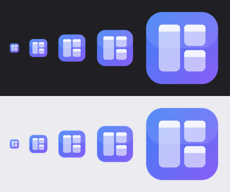
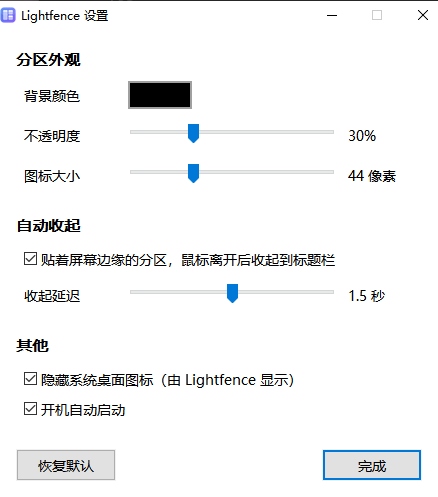

<p align="center">
  
</p>

<h1 align="center">Lightfence</h1>

<p align="center">
  A lightweight desktop fences / organizer for Windows, written in Rust<br>
  <a href="README.md">中文</a>
</p>

---

Lightfence gathers a cluttered desktop into translucent **fences**: group, tab, search and drag your icons around with an Explorer-like feel, at a fraction of the usual footprint.

It is inspired by the fence feature of tools such as XiaoZhi Desktop (a popular Chinese desktop organizer). We wanted the fences — not the resident services, watchdogs, search, wallpapers, notifications and background processes that come with them. Lightfence's goal is simple: **do fences well, and keep them light.**

## Why

While tracking down why a PC stuttered under load, the author found the cause wasn't malware but ordinary resident software: DLLs injected into every process, global hooks, watchdog processes. Each one is small; together they turn the mouse into a slideshow whenever the system is busy.

Lightfence is designed around these rules from day one:

| Principle | How |
|---|---|
| **One process** | Just `lightfence.exe`. No services, scheduled tasks or watchdogs |
| **No injection, no hooks** | Loads no DLLs into other processes; registers no global input or WinEvent hooks |
| **Zero idle cost** | Fully event-driven: the shell notifies us of desktop changes; no polling, no needless redraws |
| **Offline** | No account, telemetry, ads or update checks |
| **Your files stay put** | Fences only remember which desktop items to show; files never leave the desktop folder, and uninstalling leaves your desktop as it was |
| **Native behaviour** | Context menus, drag and drop, rename and delete are Explorer's own implementations |

### Footprint (measured on the author's PC, for reference only)

| | Lightfence | XiaoZhi Desktop (full suite incl. search, wallpaper) |
|---|---|---|
| Processes | 1 | 17 |
| Memory (private) | ~75 MB | ~440 MB |
| Idle CPU | 0 | ~2% of one core |
| WinEvent hooks | 0 | ~36 |
| Resident at boot | 1 startup entry (optional) | service, scheduled task, watchdog, 2 startup entries |

> Windows 10, i7-12700KF, ~140 desktop icons. The two differ in scope (XiaoZhi Desktop also ships search, wallpapers and widgets), so this is not a controlled benchmark — it only shows the order of magnitude.

## Features

### Fences
- Translucent fences pinned to the desktop layer: they never cover other windows and survive `Win+D`
- Move by the title bar, resize by the edges; **edge snapping** to other fences and screen edges (hold `Alt` to disable)
- **Collapse** to the title bar with the chevron or a double-click on the title
- **Auto-hide**: fences docked to a screen edge shrink to their title bar when the mouse leaves, and come back when it returns
- **Tabs**: `+` next to the title adds a tab, double-click to rename, right-click to delete; dragging icons over a tab switches to it
- **Search** across all tabs of a fence (magnifier, top right)

### Icons
- The same icons and thumbnails Explorer shows
- Double-click to open; right-click gives the **native shell context menu** (Open with, Send to, archivers, Properties…) plus "Open file location" and "Remove from fence"
- Rubber-band selection, `Ctrl` / `Shift` to extend
- Drag to reorder, to another fence, onto the desktop, or into Explorer and other apps (same as dragging from the desktop)
- Keys: `F2` rename, `Delete` to Recycle Bin, `Enter` open, `Ctrl+A` select all, `Esc` clear selection

### Desktop
- Optionally hides Explorer's own icons and takes over; items not in a fence (e.g. This PC, Recycle Bin) still sit **freely on the desktop grid**
- Right-clicking the empty desktop shows the **native desktop menu** (New, Display settings, Personalize, and entries other apps add), plus sort, refresh and paste
- Items created with "New" appear where you clicked and start in rename mode
- Follows desktop changes: new files appear, deleted ones vanish, renamed items stay in their fence

### Settings
Fence colour, opacity, icon size, auto-hide and its delay, hiding Explorer's desktop icons, start with Windows. Everything applies immediately.

<p align="center">
  
</p>

## Usage

There is no installer yet; build from source (below) and run `lightfence.exe`.

- **Settings**: tray icon → 设置… (Settings); or right-click a fence or the desktop; or launch the exe again while it is running
- **New fence**: right-click the desktop or a fence → 新建分区 (New fence)
- **Add icons**: drag them from the desktop into a fence
- **Quit**: tray icon → 退出 (Quit). Explorer's desktop icons are restored on exit

Settings are stored in `%APPDATA%\Lightfence\config.json`. The UI is currently Chinese only.

## Building

Requirements:
- Windows 10 / 11
- [Rust](https://rustup.rs/) (stable, MSVC toolchain)
- Visual Studio Build Tools with "Desktop development with C++"

```powershell
git clone <this repository>
cd lightfence
cargo build --release
```

The result is a single `target\release\lightfence.exe` that runs from anywhere.

The icon is generated by `assets/make_icon.py` (Python + Pillow); you only need it when changing the icon.

## How it works

- **Rust** + Microsoft's [windows-rs](https://github.com/microsoft/windows-rs), straight Win32 with no UI framework
- Each fence is a layered window (`WS_EX_LAYERED`) drawn with **Direct2D / DirectWrite** and pushed with `UpdateLayeredWindow` for per-pixel alpha
- Fences are owned by the window hosting `SHELLDLL_DefView`, which keeps them below all normal windows
- Icons and thumbnails come from `IShellItemImageFactory`, context menus from `IContextMenu`, drag and drop from OLE (`SHDoDragDrop`, `IDropTargetHelper`)
- Desktop changes arrive via `SHChangeNotifyRegister`
- Renames go through `IFileOperation`, so they can be undone

| File | Role |
|---|---|
| `src/main.rs` | Startup, tray, global state, desktop sync |
| `src/fence.rs` | Fence windows: drawing, layout, input, tabs, search, auto-hide |
| `src/desktop.rs` | Desktop window lookup, desktop item enumeration, change notifications |
| `src/shell.rs` | Shell context menus, drag-out, rename and other shell operations |
| `src/drop.rs` | Drop target |
| `src/editbox.rs` | Text box for renaming and search (IME-aware) |
| `src/settings.rs` | Settings window |
| `src/gfx.rs` | Direct2D drawing and layered-window surfaces |
| `src/icons.rs` | Icons, thumbnails, display names |
| `src/config.rs` | Config load/save |

## Known limitations

- The desktop layer covers the **primary monitor** only; multi-monitor support is incomplete
- Only items **on the desktop** can go into fences; dropping files from other folders isn't supported
- If the process is killed (e.g. "End task"), Explorer's icons stay hidden until Lightfence or Explorer is restarted
- The exe is unsigned, so Windows may show a warning the first time
- Memory can go lower: every icon is currently kept twice

## Roadmap

- [ ] Auto-sort rules by type (folders, shortcuts, documents, images…)
- [ ] Pinyin-initial search
- [ ] Lower memory use
- [ ] Full multi-monitor support
- [ ] Online wallpapers (Bing daily, Wallhaven)
- [ ] Installer / releases

## License

[GPL-3.0](LICENSE). You may use, modify and distribute it freely; works based on it must also be released under GPL-3.0.
