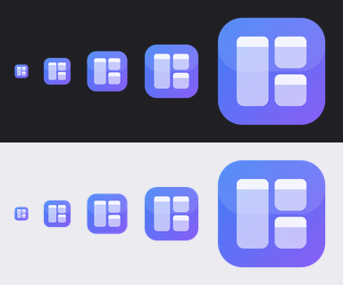
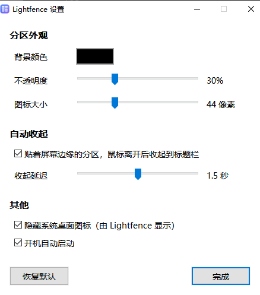

<p align="center">
  
</p>

<h1 align="center">Lightfence</h1>

<p align="center">
  轻量的 Windows 桌面分区与整理工具，用 Rust 编写<br>
  <a href="README.en.md">English</a>
</p>

---

Lightfence 把杂乱的桌面图标收进一个个半透明的「分区」：可以分类、分标签、搜索、拖动，用起来像资源管理器，占用却很低。

灵感来自小智桌面（XiaoZhi Desktop）这类工具的分区功能。我们只想要其中的「桌面分区」，不想要附带的常驻服务、守护进程、搜索、壁纸、推送和一堆后台进程。所以 Lightfence 的目标很简单：**把分区这件事做好，做轻**。

## 为什么要做它

作者在排查电脑卡顿时发现，系统里的很多卡顿并不来自病毒，而是来自各种常驻后台的软件：它们往每个程序里注入 DLL、注册全局钩子、开守护进程，单个都不起眼，加在一起就会让鼠标在高负载时变成「幻灯片」。

Lightfence 从第一天起就按下面的原则设计：

| 原则 | 做法 |
|---|---|
| **单进程** | 只有一个 `lightfence.exe`，没有服务、计划任务、守护进程 |
| **不注入、不挂钩子** | 不往其他程序里加载 DLL，不注册全局键鼠或窗口事件钩子 |
| **空闲零占用** | 完全事件驱动：桌面变化由系统主动通知，没有定时扫描和无意义的重绘 |
| **不联网** | 没有账号、统计、广告、更新检查 |
| **不碰你的文件** | 分区只记录「显示哪些文件」，文件始终留在桌面文件夹里；卸载后桌面原样恢复 |
| **原生体验** | 右键菜单、拖放、重命名、删除都直接调用 Windows 资源管理器本身的实现 |

### 资源占用（作者电脑上的实测，仅供参考）

| | Lightfence | 小智桌面（含搜索、壁纸等全家桶） |
|---|---|---|
| 进程数 | 1 | 17 |
| 内存（私有） | 约 75 MB | 约 440 MB |
| 空闲 CPU | 0 | 单核约 2% |
| 窗口事件钩子 | 0 | 约 36 |
| 开机常驻项 | 1 个启动项（可在设置里关闭） | 系统服务、计划任务、守护进程、2 个启动项 |

> 测量环境：Windows 10、i7-12700KF、约 140 个桌面图标。两者功能范围不同（小智桌面还包含搜索、壁纸、小组件等模块），所以这不是严格的对照测试，只用来说明量级差别。

## 功能

### 分区
- 半透明分区固定在桌面层：不会挡住其他窗口，按 `Win+D` 也不会消失
- 拖动标题栏移动，拖动边缘调整大小；靠近其他分区或屏幕边缘时**自动贴边**（按住 `Alt` 临时关闭）
- 点击箭头或双击标题**折叠**成只剩标题栏
- **自动收起**：贴着屏幕边缘的分区，在鼠标离开一段时间后收起到标题栏，鼠标移回标题栏就展开
- **标签页**：标题旁的 `+` 新建标签，双击标签改名，右键标签可删除；拖动图标经过某个标签时会自动切换过去
- **分区内搜索**：右上角的放大镜，可以跨所有标签按名称过滤

### 图标
- 显示和资源管理器一样的图标与缩略图
- 双击打开；右键是**系统原生右键菜单**（打开方式、发送到、压缩、属性……），顶部加了「打开文件所在位置」和「移出分区」
- 拖框多选，`Ctrl` / `Shift` 加选
- 拖放：在分区内调整顺序、拖到其他分区、拖到桌面、拖到资源管理器或其他程序（效果和从桌面拖出去一样）
- 从微信、QQ、资源管理器其他文件夹、浏览器拖进来的文件和图片，会像拖到原生桌面一样复制或移动到桌面文件夹，并落在松手的位置：桌面上的那一格，或者直接收进松手处的分区
- 快捷键：`F2` 重命名、`Delete` 删除到回收站、`Enter` 打开、`Ctrl+A` 全选、`Esc` 取消选择

### 桌面
- 可以隐藏系统自带的桌面图标，由 Lightfence 接管显示；没放进分区的图标（比如「此电脑」「回收站」）照样**自由摆在桌面网格上**
- 桌面空白处右键就是**系统原生的桌面菜单**（新建、显示设置、个性化，以及其他软件加的菜单项），另外补上了排序方式、刷新、粘贴
- 「新建」出来的文件会出现在你右键的位置，并直接进入改名状态
- 自动跟踪桌面变化：新文件自动出现，删掉的消失，重命名后仍留在原来的分区

### 设置
分区颜色、不透明度、图标大小、自动收起及延迟、隐藏系统桌面图标、开机自启。所有改动立即生效。

<p align="center">
  
</p>

## 安装与使用

目前还没有发布安装包，需要从源码编译（见下文）。编译后运行 `lightfence.exe` 即可。

- **打开设置**：右键托盘图标 → 设置…；或在分区、桌面空白处右键 → Lightfence 设置…；或者在程序运行时再启动一次 exe
- **新建分区**：在桌面空白处或分区上右键 → 新建分区
- **把图标放进分区**：直接从桌面拖进去
- **退出**：右键托盘图标 → 退出。退出时会自动恢复系统桌面图标

配置保存在 `%APPDATA%\Lightfence\config.json`。

## 从源码编译

需要：
- Windows 10 / 11
- [Rust](https://rustup.rs/)（stable，MSVC 工具链）
- Visual Studio 生成工具（勾选「使用 C++ 的桌面开发」）

```powershell
git clone <本仓库地址>
cd lightfence
cargo build --release
```

编译结果在 `target\release\lightfence.exe`，单个文件，可以放到任意位置运行。

图标由 `assets/make_icon.py` 生成（需要 Python 和 Pillow），只有修改图标时才需要重新运行。

## 技术实现

- **Rust** + 微软官方的 [windows-rs](https://github.com/microsoft/windows-rs)，直接调用 Win32，不依赖任何界面框架
- 每个分区是一个分层窗口（`WS_EX_LAYERED`），用 **Direct2D / DirectWrite** 绘制，通过 `UpdateLayeredWindow` 实现逐像素透明
- 分区挂在桌面窗口之下（owner 设为 `SHELLDLL_DefView` 的宿主），保持在所有普通窗口下方
- 图标与缩略图来自 `IShellItemImageFactory`；右键菜单来自 `IContextMenu`；拖放使用 OLE（`SHDoDragDrop`、`IDropTargetHelper`）
- 桌面变化通过 `SHChangeNotifyRegister` 由系统主动通知
- 重命名使用 `IFileOperation`，支持撤销

源码结构：

| 文件 | 作用 |
|---|---|
| `src/main.rs` | 启动、托盘、全局状态、桌面同步 |
| `src/fence.rs` | 分区窗口：绘制、布局、交互、标签、搜索、自动收起 |
| `src/desktop.rs` | 桌面窗口定位、桌面文件枚举、变化监听 |
| `src/shell.rs` | 系统右键菜单、拖出、重命名等 Shell 操作 |
| `src/drop.rs` | 拖放接收 |
| `src/editbox.rs` | 改名与搜索用的输入框（支持输入法） |
| `src/settings.rs` | 设置窗口 |
| `src/gfx.rs` | Direct2D 绘制与分层窗口表面 |
| `src/icons.rs` | 图标、缩略图、显示名称 |
| `src/config.rs` | 配置读写 |

## 已知限制

- 桌面层目前只覆盖**主显示器**，多显示器支持还不完善
- 如果程序被强制结束（比如任务管理器里「结束任务」），系统桌面图标会保持隐藏，重新启动 Lightfence 或资源管理器即可恢复
- exe 没有数字签名，首次运行时 Windows 可能会弹出安全提示
- 内存还有优化空间：目前每个图标在内存里保存了两份

## 路线图

- [ ] 按类型自动收纳（文件夹、快捷方式、文档、图片……）
- [ ] 搜索支持拼音首字母
- [ ] 降低内存占用
- [ ] 完整的多显示器支持
- [ ] 在线壁纸（必应每日壁纸、Wallhaven）
- [ ] 发布安装包

## 协议

[GPL-3.0](LICENSE)。你可以自由使用、修改和分发，但基于本项目发布的作品也需要以 GPL-3.0 开源。
